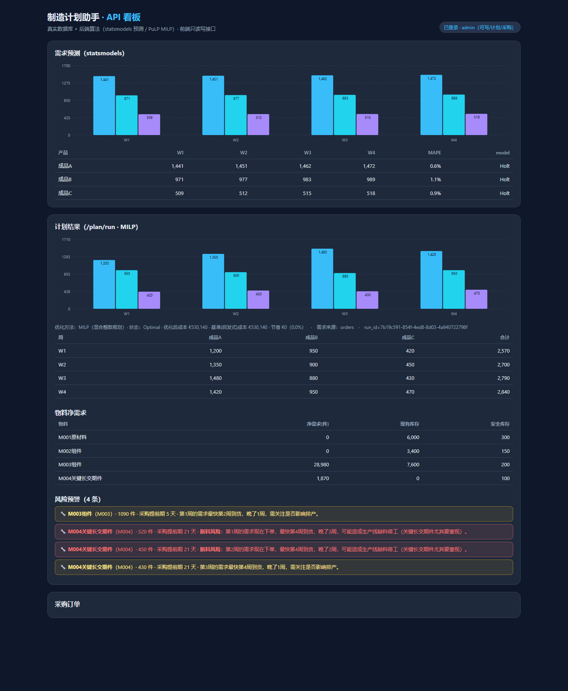
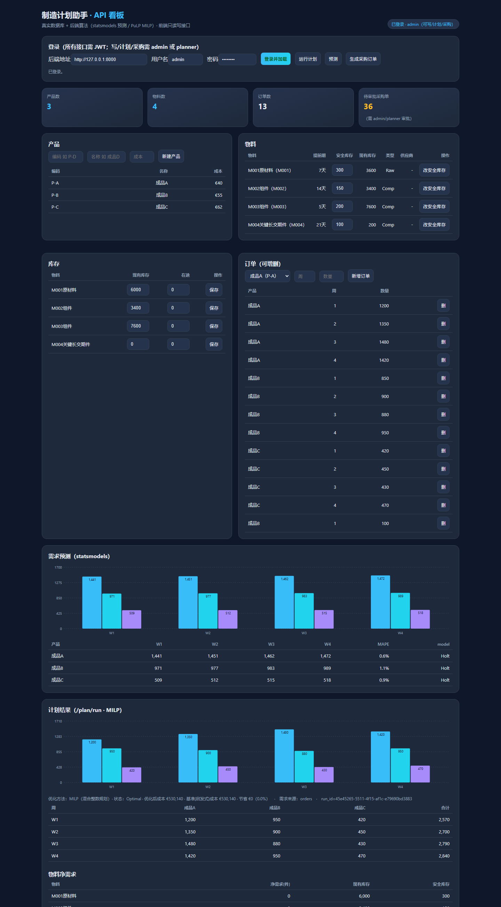

# 制造计划助手 · AI 供应链计划系统

一个**订单 → 生产计划 → BOM → MRP → 采购计划**的端到端决策支持系统，面向供应链计划（Production Planning / Material Planning / Demand Planning）方向求职作品集。

**业务闭环**：需求预测 → 主生产计划（MPS）→ 物料净需求（MRP）→ 采购订单分级 → 风险预警。

## 界面预览

**运行计划 → 物料净需求 → 风险预警（断料风险分级）**



**总览看板（需求预测 · 库存 · 订单 · 计划）**



## 亮点

- **端到端计划闭环**：订单/预测 → BOM 拆解 → 物料净需求（含库存/在途/安全库存/提前期反冲）→ 采购建议。
- **AI + 运筹**：需求预测用 statsmodels（留出法 MAPE），生产计划用 PuLP **MILP** 容量受限排产。
- **风险预警**：产能超载 + **提前期越界**分级预警（红/黄），识别断料风险。
- **人机协同**：采购订单按风险分级——低风险 AI 自动放单，高风险（提前期越界/大额/长交期件）转人工审批。
- **完整技术栈**：FastAPI + SQLAlchemy + JWT/RBAC（admin/planner/viewer）+ 前端看板 + Alembic 迁移。

## 技术栈

Python 3.11+ · FastAPI · SQLAlchemy · PuLP(MILP) · statsmodels · JWT · SQLite(本地)/PostgreSQL(生产)

## 快速开始

双击 **`start-all.bat`** 自动：装依赖 → 建库灌数据 → 起后端(8000) 与前端(8080) → 打开浏览器。

账号：`admin / admin123`（管理员）· `planner / plan123` · `viewer / view123`

详见 [`backend/README.md`](backend/README.md) 与 `SPEC.md`（设计文档）。

## 在线演示：https://1468795753hkx-png.github.io/scm-planning-demo/
本项目提供交互式前端演示，使用模拟数据展示需求与订单管理、主生产计划（MPS）、物料需求计划（MRP）、库存管理、采购建议及风险预警等核心功能。

说明： 在线演示使用模拟数据，部分功能为前端交互模拟，不代表完整后端算法的实际运行结果。

完整项目源码、技术实现及本地部署说明，请参阅本仓库中的相关目录与文档。

## 目录

```
backend/    FastAPI 后端（业务逻辑 + 算法 + 鉴权）
frontend/   前端看板（调用 /api/*）
alembic/    数据库迁移
start-all.* 一键启动脚本
```
